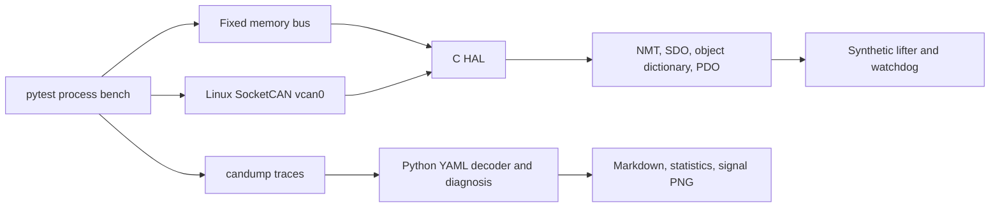

# CAN bench lab

A C11 and Python 3.11 simulation of a synthetic lifter controller on a classic CAN bus. It includes a CANopen-style node, a fixed-capacity in-memory bus, a Linux SocketCAN backend, a process test bench, log decoding, timing statistics, a signal plot, and a Markdown diagnosis.

Everything builds and runs on a GitHub-hosted runner. No hardware, additional accounts, API keys, PC installs, or local Docker are needed. [GitHub Actions](https://github.com/hamza2829/can-bench-lab/actions) uploads the `can-bench-results` artifact with logs, injected-fault events, signal plots, diagnosis reports, static-analysis output, sanitizer output, coverage reports, and measured test counts.

## Architecture



`core/` uses only the C standard library and fixed-size storage. It allocates no dynamic memory. The HAL has send and receive callbacks plus a context pointer. `backends/socketcan.c` provides the Linux implementation. `app/main.c` runs the same node as a host process. `python/canbench/` contains the process bench and analysis tools. Unity is fetched with CMake FetchContent at version `v2.6.1`.

## Three build and test commands

These commands run in CI. They also work in an already prepared Linux development environment. No manual local setup is required for this task. The CI workflow installs its tools and Python package on the runner.

```sh
cmake -S . -B build -DCMAKE_BUILD_TYPE=Debug -DCB_COVERAGE=ON
```

```sh
cmake --build build --parallel 2 && ctest --test-dir build --verbose
```

```sh
python -m pytest -v
```

The analysis CLI takes a timestamped trace, `--description examples/lifter.yaml`, and `--output DIRECTORY`. The installed command is `canbench`; its `--help` describes the optional signal and nominal bitrate. The host node accepts `--memory` or `--socketcan INTERFACE`. Its node id is 1 in the example process, while the C library accepts ids 1 through 127.

## C protocol subset

The frame API validates standard 11 bit ids and DLC 0 through 8. Its encoder writes a portable lab record of 11 bytes: little endian 16 bit id, DLC, and eight payload bytes with unused bytes zeroed. This record is not a physical CAN bitstream and contains no CAN CRC, bit stuffing, or arbitration. SocketCAN uses the kernel's native `struct can_frame` instead.

The NMT states are initialising (0), pre operational (127), operational (5), and stopped (4). Initialisation emits a boot-up frame before entering pre operational. NMT supports start, stop, enter pre operational, reset node, reset communication, targeted commands, and broadcast commands. Reset communication restores the heartbeat period and stops the motor while preserving application objects; reset node restores all defaults. Heartbeats are emitted on NMT state changes and periodically.

SDO uses request `0x600 + node id` and response `0x580 + node id`. Upload and download support expedited, size-indicated transfers of up to four bytes. The example objects use one, two, or four bytes with little endian values. Unsupported commands, missing indices or subindices, read-only writes, length mismatches, invalid values, and inappropriate motor state produce explicit abort codes. Client aborts receive no response. SDO is available in pre operational and operational states; PDO is available only in operational state.

| Index, subindex 0 | Size | Access | Meaning |
| --- | ---: | --- | --- |
| 0x1000 | 4 | Read | Synthetic device type, zero |
| 0x1001 | 1 | Read, TPDO | Error register; bit 0 means invalid application data, bit 4 means command continuity/watchdog fault |
| 0x1017 | 2 | Read/write | Heartbeat interval, 10 to 5000 ms, default 100 |
| 0x2000 | 2 | Read, TPDO | Simulated position, 0 to 1000 mm |
| 0x2001 | 2 | Read/write, RPDO | Target position, 0 to 1000 mm |
| 0x2002 | 1 | Read/write, RPDO/TPDO | Motor state, 0 or 1; starting requires operational state and no latched error |
| 0x2003 | 2 | Read/write | Command watchdog, 50 to 5000 ms, default 250 |
| 0x2004 | 1 | Read/write | Write 1 with motor off to acknowledge errors and reset the sequence guard; reads zero |

The generic PDO mapper checks object access, whole-object bit lengths, duplicate entries, and total size. It validates all receive values before changing an object. The example mapping is set in C, with RPDO target and motor, and TPDO position, motor, and error register.

The example RPDO at `0x200 + node id` has five bytes: target little endian U16, motor U8, sequence U8, and an XOR checksum. The checksum is `0xA5 XOR` each of the preceding four bytes. The last two bytes are a synthetic application protection trailer outside the mapped object bytes. They are not a standard CANopen safety protocol. TPDO at `0x180 + node id` has four bytes: position U16, motor U8, error U8.

Commands with bad length, invalid values, checksum mismatch, or an unexpected sequence stop the motor and latch an error. A lost refresh eventually trips the watchdog. A delayed command cannot restart the motor while a fault is latched. Acknowledgement is explicit. A sequence gap or replay is rejected; wrap from 255 to 0 is accepted. The first command after reset or acknowledgement establishes the sequence baseline.

Motion is simulated at one millimetre per 10 ms toward the target and stops at the target. If a tick arrives after watchdog expiry, the model stops before applying catch-up motion. The memory bench advances a deterministic virtual millisecond clock. SocketCAN runs against the host monotonic clock with a 2 ms polling timeout. The transition deadline test measures a host-process response within 500 ms; it does not establish real-time performance for hardware.

## CI bus selection

CI attempts `sudo modprobe vcan`, `sudo ip link add vcan0 type vcan`, and `sudo ip link set vcan0 up`. A native CAN RAW socket must open before SocketCAN tests are selected. Memory tests always run. If the runner cannot provide `vcan0`, CI records the actual commands and failures in `backend.json`, selects the memory backend, and runs no SocketCAN bench cases. This is a reported fallback, not a SocketCAN pass or a skipped test reported as success.

In the verified [CI run 41933489968](https://github.com/hamza2829/can-bench-lab/actions/runs/41933489968), all three setup commands returned zero, `vcan0` opened successfully, and all 12 SocketCAN process-bench cases passed. All 12 memory-bus cases also passed. No fallback was used in that run. Future runners can still select the recorded memory fallback if their kernel cannot provide `vcan0`.

## Log tools and diagnosis

The decoder accepts numeric-timestamp candump lines in compact `ID#HEX` or bracket `[DLC]` format, classic RTR frames, and encoded error frames. It rejects invalid DLC, extended data ids, CAN FD, malformed payloads, and decreasing timestamps with file and line context. Analyze one channel per capture. The YAML file defines unique signal names, bit start, length, optional signed conversion, scale, offset, unit, and range. Only little endian bit numbering is supported; this is a small DBC-like format, not a DBC parser.

Statistics include counts, message rate, interval mean, population standard deviation of intervals as jitter, error-frame count, and estimated bus load. Rate is count divided by the whole observed capture span. Bus load uses 47 frame and intermission bits plus payload bits, with a no-stuffing lower bound and a worst-case stuffing upper bound. Error-frame occupancy, retransmissions, and unlogged traffic are excluded. A single-frame or zero-duration capture has no rate or load estimate. `vcan` has no physical bus bitrate or arbitration delay, so these values are estimates from timestamps and configured nominal bitrate.

Diagnosis checks configured heartbeat gaps inside the capture window, SDO abort responses, short application payloads, and decoded signal ranges. It cannot infer silence after the final logged frame. The synthetic fault log produced these four findings in the verified CI run:

```text
0.350000s: SDO abort 0x06090030 at 0x2001:00: value outside allowed range
0.400000s: position out of range: 2000 mm
0.450000s: CAN error frame 0x00000004
Missing heartbeat 0x701: observed gap 900.0 ms exceeds 300 ms within capture
```

The capture contains seven frames over one second. At the configured nominal 500 kbit/s, the reported data/RTR load estimate is 0.096% to 0.116%. The separately analyzed actual memory motion-test trace produced zero configured findings. Both plots and reports are in the CI artifact.

## Measured CI results

<!-- CI_METRICS_START -->
| Metric | Measured in CI |
| --- | ---: |
| C Unity cases | 27 |
| Python pytest cases, including bench | 88 |
| Unique total | 115 |
| Memory / SocketCAN bench cases, included above | 12 / 12 |
| C cases rerun with ASan and UBSan, not added to total | 27 |
| Failures / ignored / skipped | 0 / 0 / 0 |
| C core line coverage | 100.00% (289/289) |
| Python line coverage | 96.50% (414/429) |
<!-- CI_METRICS_END -->

Measured in [CI run 41933489968](https://github.com/hamza2829/can-bench-lab/actions/runs/41933489968) for commit `690c04226a21e2f6a88273736030eb4c43ba072a`. The strict pipeline and per-file analyzer failure handling were active. Compiler, cppcheck, clang-tidy, ASan, and UBSan logs contained no diagnostics for the owned code in that run. This is line coverage, not a claim of complete branch coverage or proof of correctness.

The measured C case count comes from Unity's actual summary, not CTest's count of one harness. The same cases are rerun with AddressSanitizer and UndefinedBehaviorSanitizer and counted once in the unique total. Python counts include parameterized process-bench invocations. C core line coverage includes all four production files in `core/`, measured with gcov through gcovr after unit and bench execution. The kernel backend, host CLI, tests, and fetched Unity sources are outside that core coverage scope. Python coverage is reported separately.

CI builds owned C targets with `-Wall -Wextra -Wpedantic -Werror`, runs cppcheck warning/performance/portability checks, runs clang-tidy's Clang static analyzer and selected C-relevant bug-prone checks, executes sanitizer tests, enforces at least 80% C core line coverage, runs the Python tools and fault-injection bench, and uploads results. Static-analysis warnings fail CI. No claim is made about checks that were not enabled.

## Limitations

This is a simulation with synthetic data, not control software for a real lifting machine or a certified safety system. It does not model physical loads, acceleration, braking, sensors, mechanical limits, emergency stops, CAN arbitration, physical CRC faults, electrical faults, bus-off recovery, or hard real-time scheduling. Payload corruption is injected at the application layer on an otherwise valid CAN frame. Real CAN controllers normally detect link-layer bit corruption separately.

This is a CANopen-style subset, not a conformant or certified CANopen implementation. There is no EDS/DCF import, dynamic SDO PDO remapping, segmented or block SDO transfer, SYNC, EMCY, LSS, node guarding, multiple SDO channels, persistence, or CANopen Safety. The object dictionary is a fixed scalar table with subindex zero. The generic memory bus is a two-endpoint fixed FIFO transport, not a physical CAN scheduler. It reports queue exhaustion instead of allocating storage. The C core expects serial calls; it is not thread-safe.

The process runner and SocketCAN backend target Linux. The core itself uses standard C11 and requires caller-provided fixed storage and callbacks. The memory bench uses explicit virtual ticks, so its virtual timing does not measure scheduler latency. SocketCAN timestamps in bench logs are host receipt/send times, not hardware timestamps. Logs and plots demonstrate the modeled behavior only.

Protocol references used for the implementation: [Linux SocketCAN documentation](https://docs.kernel.org/networking/can.html), [CANopenNode SDO documentation and abort code definitions](https://canopennode.github.io/CANopenNode/group__CO__SDOserver.html), and [Unity releases](https://github.com/ThrowTheSwitch/Unity/releases/tag/v2.6.1). This lab uses its own implementation; it does not vendor the CANopenNode stack.
